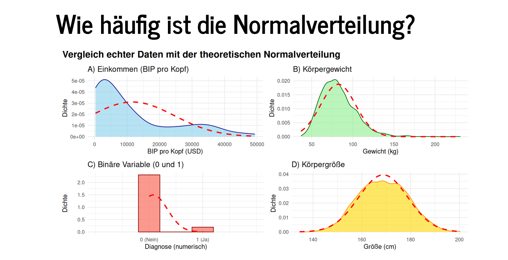
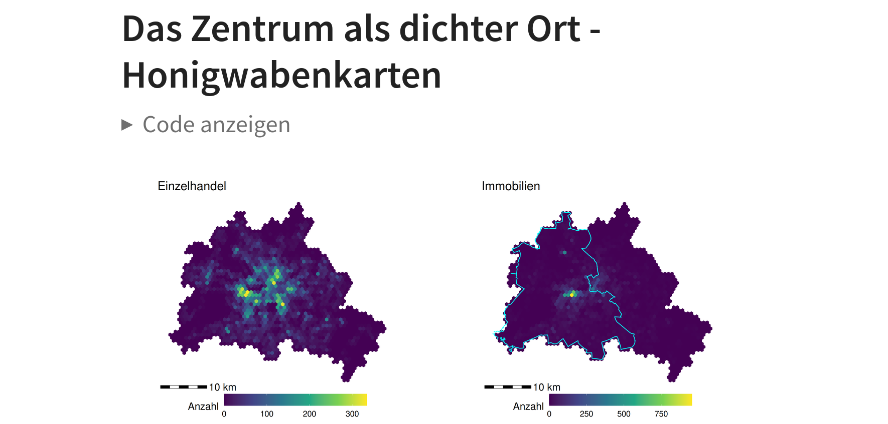
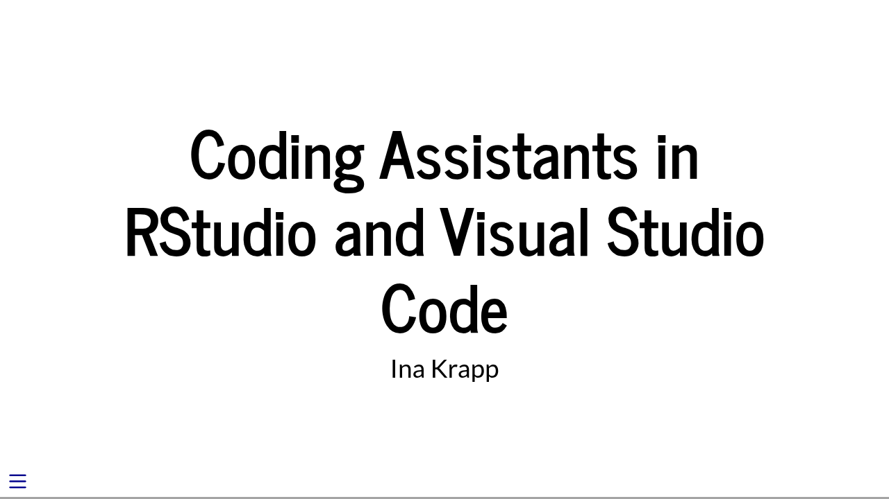

Meine Vorträge in voller Länge. (Zurzeit auf Englisch.)

<h3 class="card-title"><a href="../../presentations/Statistik/index.html">Brauchen wir „fortgeschrittenere" Statistik in der Geographie?</a></h3>

Ina Krapp · 1. Oktober 2026 · Geography Connect Convention, Osnabrück

<h3 class="card-title"><a href="../../presentations/Zentrum/index.html">Wie findet man ein Zentrum?</a></h3>

Ina Krapp

<h3 class="card-title"><a href="../../presentations/LLM_assistants/index.html">Coding Assistants in RStudio and Visual Studio Code</a></h3>

Ina Krapp

